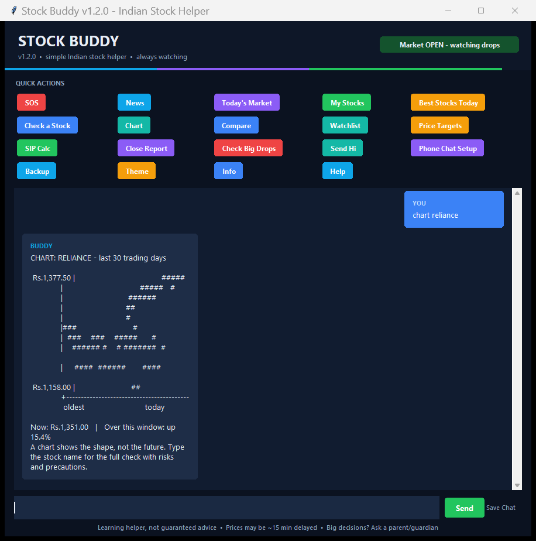

# Stock Reader / Stock Buddy 🇮🇳

[](https://github.com/namish123chandra-prog/stock-reader/actions/workflows/ci.yml)
[](https://www.python.org/)
[](LICENSE)
[](#requirements)
[](CHANGELOG.md)
[](https://github.com/namish123chandra-prog/stock-reader/stargazers)

A beginner-friendly **Indian stock market assistant** for the desktop.
It fetches live NSE prices, explains them in plain English, remembers what you
bought, watches for big drops, and can alert your phone.

Made for students and first-time investors. **No jargon. No paid data feed.**



---

## Why this project exists

Most stock apps throw charts, ratios and jargon at you. Stock Buddy does the
opposite: it gives you a simple answer, explains *why*, and reminds you about
risk. It is a learning helper, not a trading terminal.

- **India-first:** NSE stocks, rupees, IST market hours.
- **Plain English:** BUY / WAIT / AVOID with reasons and precautions.
- **Actually useful:** live prices, news, watchlists, price alerts, portfolio memory.
- **Easy to extend:** every feature is one small file in `features/`.
- **No cloud account needed:** runs on your laptop.

---

## Quick start

### Requirements

- Windows 10 or 11
- Python 3.9 or newer
- Internet connection for prices and news

### Install

**Option A — without Git:** open the repo, click **Code → Download ZIP**, extract
it, then open a terminal in that folder.

**Option B — with Git:**

```powershell
git clone https://github.com/namish123chandra-prog/stock-reader.git
cd stock-reader
```

Then install the dependencies:

```powershell
python -m pip install -r requirements.txt
python check_setup.py
```

### Run

Double-click **`Start Stock Buddy.bat`**, or run:

```powershell
python run.py
```

Prefer a terminal instead of the window?

```powershell
python run.py --text
```

---

## What it can do

### 19 buttons, plus chat

| Button | What it does |
|---|---|
| **SOS** | Sends an urgent snapshot of your stocks to your phone channels |
| **News** | Today's Indian market headlines from ET, Moneycontrol and LiveMint |
| **Today's Market** | Green/red day, Nifty move, biggest winners and losers |
| **My Stocks** | Your saved stocks, profit/loss, and a daily review |
| **Best Stocks Today** | Scores Nifty 50 companies and shows the top 5 |
| **Check a Stock** | Price, simple story, BUY/WAIT/AVOID, risk and precautions |
| **Chart** | A tiny text chart of the last 30 trading days |
| **Compare** | Side-by-side check of two stocks |
| **Watchlist** | Add or remove stocks you want watched |
| **Price Targets** | Alert when a stock crosses a price you choose |
| **SIP Calc** | See how monthly savings could grow over time |
| **Close Report** | End-of-day summary, also sent automatically at 3:35 PM IST |
| **Check Big Drops** | Anything in the watchlist down 4%+ today |
| **Send Hi** | Sends a test "Hi!" to your phone channels |
| **Phone Chat Setup** | Free Telegram bot setup for two-way chat |
| **Backup** | Creates a dated ZIP of the whole app in `backups/` |
| **Theme** | Switch between dark and light mode |
| **Info** | Version, settings and file locations |
| **Help** | Full command list, written for beginners |

### Chat examples

```text
reliance
should I buy tata motors?
chart infosys
compare reliance vs tcs
watch zomato
unwatch zomato
alert me if tcs goes above 4500
my alerts
I bought 5 reliance at 1350
sell 2 reliance
5000 per month for 10 years at 12%
what is a dividend?
help
```

Small extra: the **Save Chat** link next to Send exports the conversation to a
text file.

The analysis is deliberately simple and explainable:

- Is the price above its 50-day average?
- Did it gain or lose a lot this month?
- Is it near its yearly high or far below it?
- Is it unusually jumpy?
- Did it crash today?

Those checks produce a score, a plain-English verdict, a risk level, and
precautions. **It is not a prediction and not financial advice.**

---

## Always-on mode

Double-click **`Turn On Always-On.bat`** once. Stock Buddy will start silently
when you log in to Windows and keep watching in the background:

- big-drop alerts
- price-target hits
- 9:00 AM portfolio review
- 3:35 PM market close report

Stop it with **`Turn Off Always-On.bat`**. The laptop must be on and logged in.
Market hours and report times use **India Standard Time (IST)**, even if your PC
is set to another timezone.

> Don't run the window and the silent monitor together for long, or you may get
> duplicate alerts.

---

## Phone notifications (optional)

Laptop popups, sound and `alerts_log.txt` work with no setup. For phone alerts,
choose any of these:

| Channel | Setup | Good for |
|---|---|---|
| **Telegram** (recommended) | Message `@BotFather` → `/newbot` → paste token into `config.py` | Free two-way chat from your phone |
| **SMS** | Create a Fast2SMS account → paste API key into `config.py` | Simple text alerts |
| **WhatsApp** | Twilio trial → SID, token and sandbox number into `config.py` | WhatsApp alerts |

Keys and phone numbers live in `config.py`. They are **blank by default** so the
repo is safe to share.

---

## How it works

```text
stock-buddy/
├── run.py                  # start the desktop app or text mode
├── monitor.py              # silent always-on watcher
├── config.py               # settings, phone keys, watchlist
├── core/
│   ├── app.py              # plug-in loader + chat routing
│   ├── market.py           # yfinance prices, NSE symbols, caching
│   ├── analyze.py          # simple scoring and verdicts
│   ├── portfolio.py        # your saved stocks
│   ├── persistence.py      # tiny JSON file helper
│   └── timeutils.py        # IST market hours
├── features/               # one file per feature (the plug-in system)
│   ├── _template.py        # copy this to add a feature
│   ├── chart.py
│   ├── stock_check.py
│   ├── watchlist.py
│   └── ...
├── notifications/          # laptop, SMS, WhatsApp, Telegram
├── ui/gui.py               # Tkinter window
├── tests/                  # offline unit tests
├── docs/screenshot.png
└── requirements.txt
```

### Add a feature without changing old code

1. Copy `features/_template.py` to `features/my_feature.py`.
2. Fill in `can_handle`, `handle`, and optionally `button`, `priority`, `tick`.
3. Restart the app. The loader finds it and adds its button automatically.

```python
from core.feature import Feature


class MyFeature(Feature):
    name = "my feature"
    button = "My Feature"
    priority = 50

    def can_handle(self, text):
        return "my feature" in text

    def handle(self, text, app):
        return "Hello from my new feature!"
```

---

## Tests

The test suite runs offline and does not need real prices:

```powershell
python -m unittest discover -s tests -v
```

GitHub Actions runs the same tests, plus a compile check, on every push and
pull request.

---

## Roadmap

- [x] Live NSE prices and plain-English analysis
- [x] Portfolio memory and daily review
- [x] Big-drop alerts and price targets
- [x] Watchlist, comparison, SIP calculator
- [x] Text charts and Help button
- [x] Tests + CI
- [ ] One-click `.exe` build for Windows
- [ ] Telegram setup wizard inside the app
- [ ] Hindi / regional-language explanations
- [ ] Offline mode with the last saved prices

Have an idea? Open an issue using the templates in `.github/ISSUE_TEMPLATE/`.

---

## Contributing

Contributions are welcome, especially:

- clearer wording for beginners
- bug reports with the exact message you typed
- new NSE name aliases
- tests for features

Please read [CONTRIBUTING.md](CONTRIBUTING.md) first. Never commit API keys,
phone numbers, `portfolio.json`, `alerts_log.txt` or backups.

---

## Safety and honesty

- **Learning helper, not financial advice.** BUY/WAIT/AVOID is a simple price
  check, not a promise.
- Free prices can be **~15 minutes delayed**. Do not use this for same-day
  trading.
- Markets can fall. Never invest money you need soon.
- If you are in school, talk to a parent or guardian before investing real money.
- Report security issues privately as described in [SECURITY.md](SECURITY.md).

---

## License

MIT — see [LICENSE](LICENSE). You may use, modify and share it.

Built as a first open-source project, with a lot of help from AI. ⭐ Star the repo
if it helped you learn something.
